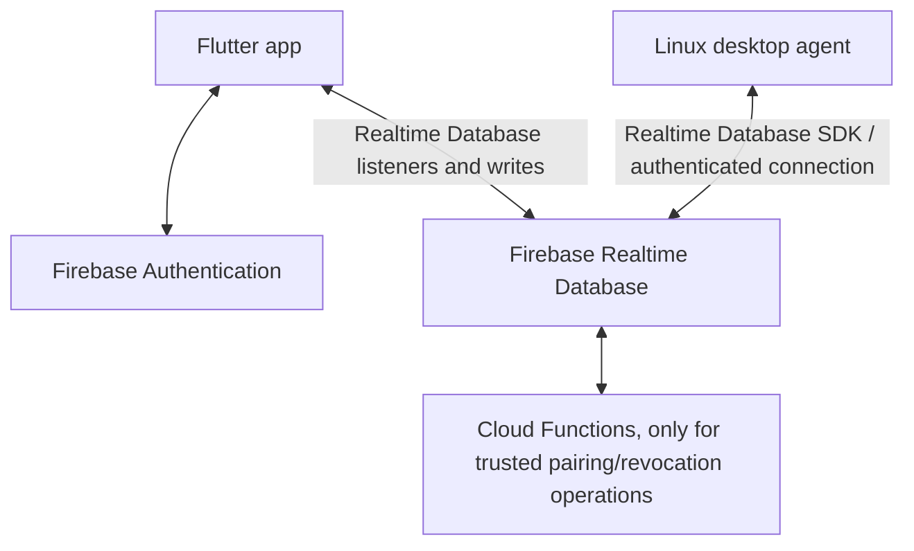

# World of IT: Firebase Architecture

## 1. High-level components

No Oracle VM or always-on custom backend is part of this design. Firebase provides the hosted database and live event delivery. Clients subscribe to narrowly scoped paths and receive changes; no polling loop or webhook is required for ordinary clipboard sync.

## 2. Responsibilities

### Flutter client
- Sign in/out using Firebase Authentication.
- Show registered devices and online status.
- Request/approve pairing and revoke devices.
- Enable/disable clipboard sync per device.
- Send remote-action requests and display command status.

### Firebase Authentication
- Handles user identity and sessions.
- The app must never implement or store user passwords itself.

### Firebase Realtime Database
- Stores user-owned device metadata, pairing requests, command records, and transient clipboard events.
- Notifies subscribed clients when relevant data changes.
- Security Rules enforce access at every read/write. Rules must validate ownership, field shapes, allowed values, and write permissions.

### Cloud Functions
- Optional for the earliest UI prototype. Use for operations clients must not be able to forge, such as validating a pairing approval, issuing/revoking device credentials, and enforcing privileged state transitions.
- Functions are not needed for every clipboard event. Deployment generally requires the Firebase Blaze plan with billing enabled; check current Firebase pricing before deployment.

### Device agent
- Starts with Linux desktop support.
- Uses Firebase-compatible authenticated access and its own registered device identity.
- Watches only authorized command/event paths.
- Executes only allowlisted actions and reports acknowledgement/result.
- Uses platform APIs for clipboard and power actions.

## 3. Pairing model
1. A user signs in on their first device and registers it as trusted.
2. A new device signs in and creates a short-lived pairing request. It is not trusted yet.
3. An already trusted device approves the request, using a one-time code/QR or explicit approval UI.
4. A trusted server-side operation verifies the request and records the new device as trusted.
5. The new device can access only its own allowed paths and the account's permitted shared events.
6. Revoking a device disables its access; database rules must consult trusted/revoked state rather than trusting a client-supplied device ID.

Do not rely on a hidden pairing screen or a random device ID alone for security. Pairing state transitions must be enforced by Security Rules and, where clients cannot safely enforce the transition, Cloud Functions.

## 4. Real-time connection model
- Flutter and the desktop agent subscribe to relevant Realtime Database paths.
- When clipboard text changes, the sender writes a small event. Authorized listeners receive the change.
- When a user requests a remote action, the app creates a command record targeted at one device. The agent listens for commands addressed to it.
- This works across separate internet connections; devices do not need to share Wi-Fi and no home-router port forwarding is needed.
- No webhook is required for these client-to-client events.

Presence can use connection status where supported plus `lastSeenAt` updates. Do not write a heartbeat every second; use a reasonable interval and mark stale devices offline.

## 5. Clipboard flow
1. Clipboard sync is off by default until enabled.
2. A local clipboard watcher detects a new text value when platform permissions allow.
3. The agent writes a record with event ID, source device ID, timestamp, and text to a short-lived per-user event path.
4. Authorized devices receive it and update their local clipboard if sync is enabled.
5. Receivers suppress their own event IDs and remote-origin updates to prevent loops.
6. Delete or expire clipboard records quickly. Prefer not to retain clipboard history. Never log clipboard content.

Clipboard content may contain passwords, tokens, and private messages. Explain this clearly, provide a per-device off switch, and consider sensitive-app exclusions where supported.

## 6. Remote commands
- Commands must be structured values such as `shutdown`, `restart`, or `sleep`, never arbitrary shell strings.
- Each command has a random ID, target device ID, creator, creation time, expiry, and status.
- The agent validates the command again before execution, rejects expired/duplicate/unsupported actions, and reports receipt and outcome.
- A disconnected or sleeping device cannot receive an ordinary live command. Expired commands must not execute later without a fresh request.
- Do not display success merely because the database write succeeded. Show accepted, completed, failed, or unconfirmed based on agent reports.

## 7. Security rules checklist
- Start with deny-by-default rules.
- Authenticated users can access only their own account-scoped records.
- Pairing requests are short-lived and one-time. Only an already trusted device can approve them, and the approval must be validated.
- Clients cannot directly mark arbitrary devices trusted, change ownership, or forge command success.
- Limit writable fields and validate allowed actions, sizes, and timestamps.
- Revoke device access immediately when removed.
- Never embed Admin SDK credentials in client apps.
- Avoid logging tokens or clipboard payloads.

## 8. Platform limits
- Internet is required for ordinary remote commands.
- A powered-off or disconnected device cannot receive a command.
- Android/iOS background clipboard access is restricted; desktop is the first practical clipboard MVP.
- Firebase has quota, rate, connection, and bandwidth limits. Monitor usage and configure budget alerts if billing is enabled.
